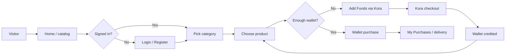
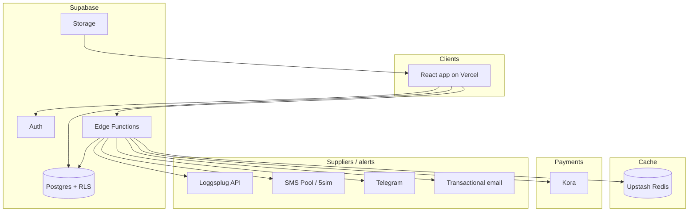
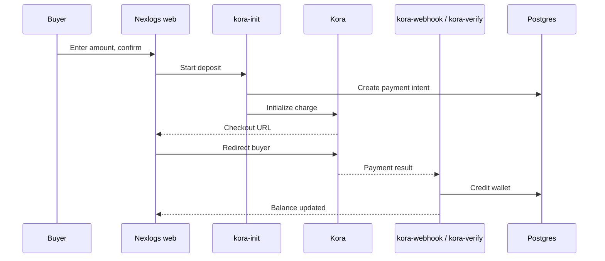

# Nexlogs

Nexlogs is a production digital marketplace for SMS verification numbers, RDP plans, and social / digital products. Buyers fund a wallet, shop by category, and receive delivery in-app (or via Telegram for supported products). Admins manage catalog, stock sync, wallets, and support from a protected dashboard.

**Live site:** [https://www.nexlogs.site](https://www.nexlogs.site)

Built with React 19, Vite, TypeScript, Tailwind CSS v4, and Supabase (PostgreSQL, Auth, Edge Functions, RLS).

---

## How Nexlogs works

At a high level:

1. **Guests** browse the home page, featured products, and public pages (RDP / SMS landing, legal).
2. **Signed-in buyers** open shop categories, buy with wallet balance, top up via **Kora**, and view orders in **My Purchases**.
3. **Edge Functions** handle payment init/verify, public catalog caching, SMS providers, Loggsplug stock sync, email, and Telegram alerts.
4. **Postgres + RLS** store users, wallets, products, orders, and admin-only data. Redis (Upstash) caches public catalog reads.

### Buyer journey



### System architecture



### Wallet top-up flow



### Catalog & categories

- **`public-catalog`** Edge Function serves categories, featured products, paginated listings, and **shop availability** (which categories currently have in-stock items, including Loggsplug).
- Responses are cached in Redis so the homepage stays fast.
- The category dropdown hides empty categories; **RDP** stays visible as its own flow (`/purchase-rdp`).
- Stocked marketplace products appear on home and `/marketplace/:slug` category pages.

---

## Features

### Customers

- **Authentication** — Email/password and Google Sign-In
- **Marketplace** — Categories, search, sort, featured listings, deep-links
- **Wallet checkout** — Add funds with Kora; pay with wallet balance
- **My Purchases** — Order history and delivered credentials / instructions
- **RDP plans** — Purchase remote desktop plans
- **SMS numbers** — Buy verification numbers (provider-backed)
- **Profile & support** — Wallet balance, FAQ, Telegram support

### Admin

- **Dashboard** — Users, products, categories, orders, coupons, tickets
- **Loggsplug sync** — Supplier catalog / stock sync
- **Wallet & transactions** — Deposits, purchases, manual credits (NGN)
- **Site content** — Hero slides, FAQ, support channels, policies
- **Email** — Transactional mail, HTML campaigns, broadcasts
- **Alerts** — Telegram order notifications, activity logs

### Platform

- **Row Level Security (RLS)** on Supabase tables
- **Realtime** catalog / wallet / admin updates where enabled
- **Redis-backed public catalog** via `public-catalog`
- **Soft deploy updates** — clients can pick up new frontend builds without a hard refresh where configured

---

## Tech Stack

| Layer | Technology |
|-------|------------|
| Frontend | React 19, Vite 8, TypeScript, React Router v7 |
| Styling | Tailwind CSS v4, Radix UI primitives |
| Data | TanStack Query, Zustand |
| Forms | React Hook Form + Zod |
| Backend | Supabase (PostgreSQL, Auth, Storage, Edge Functions) |
| Cache | Upstash Redis (public catalog) |
| Payments | Kora (wallet top-ups) |
| Suppliers | Loggsplug, SMS Pool, 5sim |
| Email | Supabase Edge Functions + optional Node API (`server/`) |
| Deployment | Vercel (frontend), Supabase (database & functions) |

---

## Project Structure

```
Nexlogs/
├── client/                    # React frontend (Vercel root)
│   ├── e2e/                   # Playwright live / local tests
│   └── src/
│       ├── components/
│       ├── contexts/
│       ├── hooks/
│       ├── layouts/
│       ├── lib/
│       ├── pages/
│       ├── routes/
│       ├── services/
│       └── types/
├── supabase/
│   ├── migrations/            # SQL schema, RPCs, RLS
│   ├── functions/             # Edge Functions
│   │   └── _shared/           # cors/auth helpers (http.ts), Redis, fees, etc.
│   └── seed.sql
├── server/                    # Optional Node email API
├── scripts/
├── .env.example
├── DEPLOYMENT.md
├── DEPLOYMENT_EMAIL.md
└── client/GOOGLE_SIGNIN.md
```

Important shared Edge helper: `supabase/functions/_shared/http.ts` — CORS headers, JSON responses, service-role clients, auth, and admin checks used by functions such as `public-catalog`, `kora-init`, and `kora-verify`.

---

## Quick Start

### Prerequisites

- **Node.js 22.x**
- A [Supabase](https://supabase.com) project
- [Supabase CLI](https://supabase.com/docs/guides/cli) (optional, for `db push` / function deploys)

### 1. Install dependencies

```bash
git clone <repo-url>
cd Nexlogs
npm install
```

### 2. Configure environment

```bash
cp client/.env.example client/.env
```

Minimum variables for local development:

```env
VITE_SUPABASE_URL=https://your-project.supabase.co
VITE_SUPABASE_ANON_KEY=your-anon-key
VITE_APP_URL=http://localhost:5173
VITE_APP_NAME=Nexlogs
VITE_USE_MOCK_DATA=false

# Optional — Google Sign-In (public client ID only)
VITE_GOOGLE_CLIENT_ID=your-client-id.apps.googleusercontent.com
```

Secrets (Kora, Loggsplug, SMS, email, Redis, Telegram) belong in **Supabase Edge Function secrets** or `server/.env` — not in the Vercel frontend bundle. See `.env.example` and `client/.env.example`.

Production `APP_URL` for Edge Functions should be `https://www.nexlogs.site`.

### 3. Run database migrations

```bash
supabase link --project-ref your-project-ref
supabase db push
```

Or run files in `supabase/migrations/` in order via the SQL Editor, then optionally `supabase/seed.sql`.

### 4. Configure Google Sign-In

See [`client/GOOGLE_SIGNIN.md`](./client/GOOGLE_SIGNIN.md).

### 5. Create an admin user

Register on the site, then:

```sql
UPDATE profiles SET role = 'admin' WHERE email = 'your@email.com';
```

### 6. Start the dev server

```bash
npm run dev
```

Open [http://localhost:5173](http://localhost:5173)

---

## Key Edge Functions

| Function | Role |
|----------|------|
| `public-catalog` | Cached categories, featured products, listings, shop availability |
| `kora-init` / `kora-verify` / `kora-webhook` | Wallet deposits via Kora |
| `loggsplug` | Supplier sync / purchase |
| `smspool` / `fivesim` | SMS number flows |
| `send-transactional-email` | Purchase / deposit emails |
| `telegram-order-alert` | Admin order alerts |

Deploy example:

```bash
supabase functions deploy public-catalog kora-init kora-verify --project-ref your-project-ref
```

---

## Scripts

| Command | Description |
|---------|-------------|
| `npm run dev` | Start Vite dev server (`client/`) |
| `npm run build` | Production build |
| `npm run preview` | Preview production build |
| `npm run lint` | ESLint (`client/`) |
| `npm run test:e2e --workspace=client` | Playwright e2e (see `client/e2e/`) |

Live e2e against production:

```bash
cd client
E2E_BASE_URL=https://www.nexlogs.site npm run test:e2e -- --project=chromium
```

Requires `client/.env.e2e` with `E2E_TEST_EMAIL` / `E2E_TEST_PASSWORD` for authenticated flows.

---

## Deployment

| Component | Platform |
|-----------|----------|
| Frontend | Vercel — **Root Directory** = `client` |
| Database, Auth, Functions | Supabase |

Guides:

- [`DEPLOYMENT.md`](./DEPLOYMENT.md) — Vercel + Supabase
- [`DEPLOYMENT_EMAIL.md`](./DEPLOYMENT_EMAIL.md) — Email setup
- [`client/VERCEL_ENV.md`](./client/VERCEL_ENV.md) — Vercel env vars

---

## Key Routes

| Path | Description |
|------|-------------|
| `/` | Home, featured catalog, category entry |
| `/marketplace/:slug` | Category product list (signed-in) |
| `/add-funds` | Wallet top-up (Kora) |
| `/purchases` | Order history |
| `/purchase-rdp` | RDP plans |
| `/buy-numbers` | SMS verification numbers |
| `/privacy` `/refund` `/terms` | Legal |
| `/admin` | Admin dashboard (`role = admin`) |

---

## License

Private — All rights reserved.
